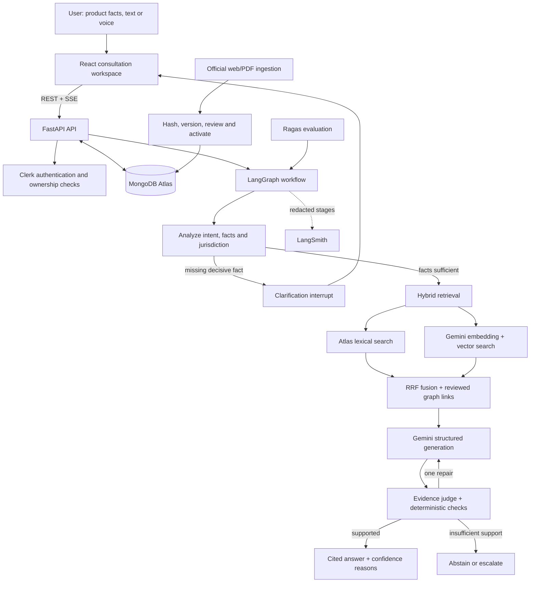

<div align="center">

# IP-SAKTI Sahayak

### Source-grounded AI assistance for Ayurveda intellectual property and regulatory research

[](https://ipsakti-ten.vercel.app/)


Built with React, FastAPI, MongoDB Atlas, Gemini and LangGraph.

</div>

## Overview

IP-SAKTI Sahayak helps Ayurveda practitioners, researchers, cultivators, startups and MSMEs navigate the overlap between product classification, intellectual property, regulation and Access-and-Benefit-Sharing (ABS).

The assistant gathers product facts, asks one necessary clarification at a time, retrieves reviewed evidence from official sources and returns a structured answer with citations, uncertainty and practical next steps. Indian and international questions stay in separate jurisdiction scopes so their legal assumptions are not mixed.

> IP-SAKTI provides general information based on cited sources. It is not a substitute for professional legal or regulatory advice.

## Core capabilities

- **Formulation-first guidance** — supports provisional assessment of classical medicines, proprietary medicines, new drugs, phytopharmaceuticals, Ayurveda Aahara, nutraceuticals and cosmetics.
- **Commercialisation pathways** — connects classification with relevant IP routes, regulatory considerations, ABS obligations and traditional-knowledge risks.
- **Jurisdiction isolation** — maintains separate research scopes for India, international systems, the United States, the European Union and the United Kingdom.
- **Human-controlled clarification** — asks a focused MCQ or free-text question when a missing fact would materially change the research path.
- **Traceable answers** — resolves every citation through server-controlled source records containing the authority, official URL, locator, excerpt and immutable document version.
- **Validated release** — checks claim support, citation identity, jurisdiction, dates and uncertainty before publishing an answer; unsupported conclusions are repaired once or withheld.
- **Real-time visibility** — streams operational stages and elapsed time through Server-Sent Events without exposing private reasoning or unfinished legal claims.
- **Multilingual foundation** — includes English/Hindi product flows and provider boundaries for Bhashini speech and translation services.

## System architecture



The workflow is bounded: one optional search rewrite and one answer repair are allowed. Retrieved documents are treated as evidence, never as executable instructions.

## RAG and evidence pipeline

1. Curate permitted official webpages and PDFs from sources such as India Code, IP India, NBA, CDSCO, FSSAI, WIPO, WTO, CBD, FDA, EMA and MHRA.
2. Record provenance and content hashes, then create immutable document versions.
3. Preserve section and page locators while chunking; embed and index only reviewed versions.
4. Run lexical and vector retrieval concurrently with identical jurisdiction, access, version and legal-status filters.
5. Fuse both rankings with Reciprocal Rank Fusion and expand only reviewed, version-matched graph relations.
6. Generate from the selected evidence, resolve citations on the server and run a separate evidence-support review.

The active engineering corpus contains **19 official documents and 732 reviewed chunks**. Its exact source metadata and review notes are versioned in the [reviewed corpus manifest](corpus/source-configs/reviewed-manifest.json).

## Evaluation snapshot

Results below come from the published English engineering benchmark. They are automated estimates with small, metric-specific sample sizes—not a legal-correctness certification.

| Measure | Result | Evaluated cases |
|---|---:|---:|
| Ragas faithfulness | **0.957** | 5 |
| Ragas answer correctness | 0.554 | 8 |
| Context precision | 0.654 | 10 |
| Context recall | **1.000** | 10 |
| Status accuracy | 76.9% | 13 |
| Citation resolution | **49 / 49** | 13-case run |
| Jurisdiction-scope violations | **0** | 13-case run |
| Corpus retrieval Hit@8 | **19 / 19** | 19 documents |

Six cases experienced at least one automated-judge timeout, so denominators are shown with every metric. See the published [answer-quality report](frontend/public/benchmarks/report.json) and [retrieval comparison](frontend/public/benchmarks/retrieval.json) for reproducibility metadata and limitations.

## Technology stack

| Layer | Technology |
|---|---|
| Frontend | React 19, JavaScript/JSX, Material UI, TanStack Query, React Router, i18next |
| Backend | FastAPI, Pydantic, PyMongo Async, Uvicorn |
| AI workflow | LangGraph, Gemini 2.5 Flash, structured outputs |
| Retrieval | MongoDB Atlas lexical search, vector search, Gemini embeddings, RRF |
| Identity | Clerk |
| Observability | Structured application logs, LangSmith traces, stage timing and token usage |
| Evaluation | Ragas, deterministic citation/scope tests, pytest, Vitest and Playwright |

## Run locally

### Prerequisites

- Node.js 20 or newer
- Python 3.11 or newer
- MongoDB Atlas, Gemini and Clerk credentials for live mode

### Frontend demo

The demo workspace runs without a backend or credentials.

```powershell
cd frontend
npm.cmd install
Copy-Item .env.example .env.local
npm.cmd run dev
```

Open the URL printed by Vite, normally `http://127.0.0.1:5173`.

### Live application

Create a root `.env` from `.env.example` and set at least:

```dotenv
MONGODB_URI=your_atlas_connection_string
GEMINI_API_KEY=your_gemini_api_key
CLERK_SECRET_KEY=your_clerk_secret_key
APP_ORIGIN=http://127.0.0.1:5173
```

Then configure `frontend/.env.local`:

```dotenv
VITE_DEMO_MODE=false
VITE_CLERK_PUBLISHABLE_KEY=your_clerk_publishable_key
```

Install and start the backend from the project root:

```powershell
python -m venv .venv
.venv\Scripts\python.exe -m pip install -e ".\backend[test,evaluation]"
.venv\Scripts\python.exe -m uvicorn app.main:app --reload --host 127.0.0.1 --port 8000
```

In a second terminal:

```powershell
cd frontend
npm.cmd install
npm.cmd run dev
```

Credentials remain server-side. Bhashini, LangSmith and permissioned paid-source connectors are optional and require their respective authorized credentials.

## Verification

Run the credential-free checks from the project root:

```powershell
powershell -ExecutionPolicy Bypass -File scripts/check.ps1 -Browser
```

Or run the suites independently:

```powershell
.venv\Scripts\python.exe -m pytest backend/tests -q
cd frontend
npm.cmd test
npm.cmd run build
npm.cmd run test:e2e
```

Playwright requires Chromium once: `npx.cmd playwright install chromium`.

## Repository structure

```text
AyurIP/
├── frontend/               React application, demo fixtures and browser tests
├── backend/
│   ├── app/                API, security, retrieval and LangGraph workflow
│   ├── ingestion/          Source import, versioning, review and activation
│   └── tests/              Backend and RAG tests
├── corpus/
│   ├── catalog.json        Public source directory
│   └── source-configs/     Search indexes, policies and reviewed manifest
├── scripts/                Offline and live readiness checks
└── README.md
```

## Responsible-use boundaries

- Answers are informational and retain a standing legal-advice disclaimer.
- Evidence confidence describes source support and missing facts; it is not a probability of legal correctness.
- The current evaluation is engineering-reviewed and has not received qualified legal certification.
- TKDL records remain access-controlled; the project exposes public information and authorized-access pointers only.
- Bhashini and subscription-source adapters require provider approval and are unavailable until configured and tested.
- New or amended sources remain inactive until their version, extraction, applicability and locators are reviewed.

---

<div align="center">
Built for Smart India Hackathon 2026 · Problem Statement SIH26045
</div>
